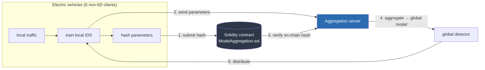

# V2Guard — Federated + Blockchain Intrusion Detection for V2G Networks

Research prototype from my Master's thesis: **"Privacy-Preserving Blockchain-Driven Intrusion
Detection System for Enhanced Security in Vehicle-to-Grid Networks"** (University of Abdelhamid
Mehri, 2025).

[](https://python.org)
[](https://flower.ai)
[](contracts/ModelAggregation.sol)
[](LICENSE)

---

## The problem

A Vehicle-to-Grid (V2G) network lets electric vehicles send power back to the grid. That makes
every EV a networked participant in grid operation — and a target. Attack traffic (message
injection, false data injection, masquerading) increasingly looks like normal charging traffic.

The standard defence, centralised intrusion detection, fails here for three reasons:

1. **Privacy** — shipping all traffic to one server exposes driver location and charging behaviour.
2. **Resilience** — the aggregator is a single point of failure, often reachable over a public
   charging cable.
3. **Scale** — central collection does not survive millions of vehicles.

V2Guard inverts the architecture: **the data never leaves the vehicle.** Only model parameters
move, and every parameter update is anchored on a blockchain so the aggregator can verify it was
not tampered with.

---

## Architecture



**Why the hash on-chain matters:** the aggregation server cannot silently substitute or modify a
client's update. If the parameters it receives do not hash to the value recorded on-chain, the
update is rejected. Trust is moved from the server to the ledger.

**What it does *not* solve** (and this is deliberate — see [Limitations](#limitations)): a hash
proves an update was not *modified*, not that it is *benign*. A malicious client can submit a
validly hashed, poisoned update.

---

## Results

Trained on **NSL-KDD** and **UNSW-NB15**, partitioned across **6 non-IID simulated vehicle
clients**, Random Forest vs. Deep Neural Network under identical conditions.

### NSL-KDD

| Model | Task | Accuracy | Notes |
|---|---|---|---|
| **Random Forest** | Binary | **99.58%** | Best accuracy/cost trade-off |
| **Random Forest** | Multiclass | **99.56%** | Fast; handles imbalance well |
| **DNN** | Binary | 97.14% | |
| **DNN** | Multiclass | 97.06% | Best recall on rare **U2R** class |

### Blockchain overhead

| Metric | Value |
|---|---|
| Contract | `ModelAggregation.sol` (Solidity ^0.8.0) |
| Network | Local Ethereum testnet (Ganache) |
| Cost per aggregation round | **≈ 0.0005 ETH** |
| Rounds for RF convergence | 1 |

The on-chain layer is cheap enough to run at V2G update frequency — that was the point of
measuring it.

> **Reproducibility note:** these figures come from the thesis notebooks and the defence
> presentation. They have not been peer-reviewed. Re-run the code to confirm before citing.

---

## Repository layout

```
├── src/
│   ├── federated_learning.py     # Flower clients + blockchain-anchored aggregation
│   └── centralized_baseline.py   # Centralised control experiment (no FL, no chain)
├── contracts/
│   └── ModelAggregation.sol      # Hash registry for model updates, per round
├── data/
│   └── README.md                 # How to obtain NSL-KDD / UNSW-NB15
├── requirements.txt
└── .env.example
```

---

## Quickstart

```bash
git clone https://github.com/[username]/v2guard-federated-blockchain-ids.git
cd v2guard-federated-blockchain-ids
python -m venv .venv && source .venv/bin/activate
pip install -r requirements.txt
```

**1. Get the data** — see [`data/README.md`](data/README.md). Put `KDDCombined.txt` in `data/`.

**2. Start a local chain**

```bash
npm install -g ganache
ganache --port 7545
```

**3. Deploy the contract**

```bash
pip install eth-brownie   # or use Truffle, as in the thesis
# deploy contracts/ModelAggregation.sol, note the address
```

**4. Configure**

```bash
cp .env.example .env
# edit .env: CONTRACT_ADDRESS, PRIVATE_KEY (a throwaway Ganache key only), NSL_KDD_PATH
```

**5. Run**

```bash
export $(grep -v '^#' .env | xargs)
python src/federated_learning.py
python src/centralized_baseline.py   # control experiment
```

---

## Limitations

Written down on purpose. This is a research prototype, not a product.

| # | Limitation | Why it matters |
|---|---|---|
| 1 | **Integrity ≠ semantics.** On-chain hashes detect tampering in transit, not poisoned updates from a malicious client. | A Byzantine client can degrade the global model while passing every check. |
| 2 | **No secure aggregation, no differential privacy.** Parameters are sent in the clear to the aggregator. | Model updates leak training data. The aggregator still sees everything. |
| 3 | **The aggregator is still trusted** for correct aggregation. | Trust moved from storage to compute — progress, not a solution. |
| 4 | **Offline evaluation.** No real-time deadline, no link loss, no embedded hardware. | V2G detection must answer before charging negotiation completes. |
| 5 | **Simulated clients**, not real vehicles; benchmark datasets, not captured V2G traffic. | Non-IID partitioning is a proxy for real heterogeneity. |
| 6 | **Single aggregation round** for RF convergence. | Convergence behaviour over many rounds is untested. |

---

## Roadmap (the PhD direction)

- [ ] Add secure aggregation + DP-SGD and measure the damage to Byzantine-robust aggregation
- [ ] Semantic verification of updates, not just hash integrity
- [ ] Hardware-in-the-loop testbed with power-system simulation
- [ ] Report detection latency and false-isolation cost, not only accuracy

---

## Citation

```bibtex
@mastersthesis{azedine2025v2guard,
  author  = {Azedine, Hamza and Bourouis, Adam},
  title   = {Privacy-Preserving Blockchain-Driven Intrusion Detection System for
             Enhanced Security in Vehicle-to-Grid Networks},
  school  = {University of Abdelhamid Mehri, NTIC Faculty},
  year    = {2025},
  type    = {Master's thesis},
  note    = {Advisor: Dr. Houda Hafi}
}
```

## Acknowledgements

Thesis co-author **Adam Bourouis**; advisor **Dr. Houda Hafi**, University of Abdelhamid Mehri.
Built with [Flower](https://flower.ai), [scikit-learn](https://scikit-learn.org),
[Web3.py](https://web3py.readthedocs.io), and [Truffle](https://trufflesuite.com).

## License

MIT — see [LICENSE](LICENSE).

## Security

This repository contains **no credentials**. The `.env` file is gitignored. If you fork this and
paste a real private key anywhere, assume it is compromised — Ganache keys are throwaway, mainnet
keys are not.
